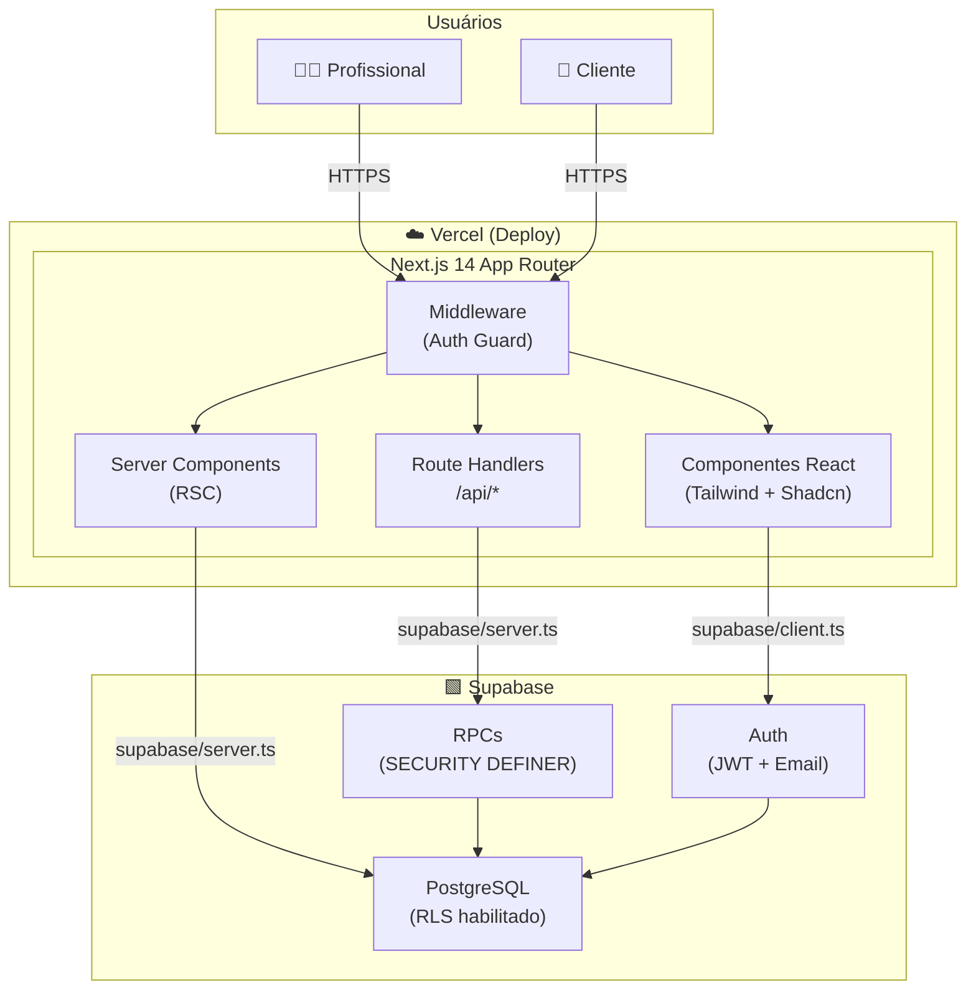
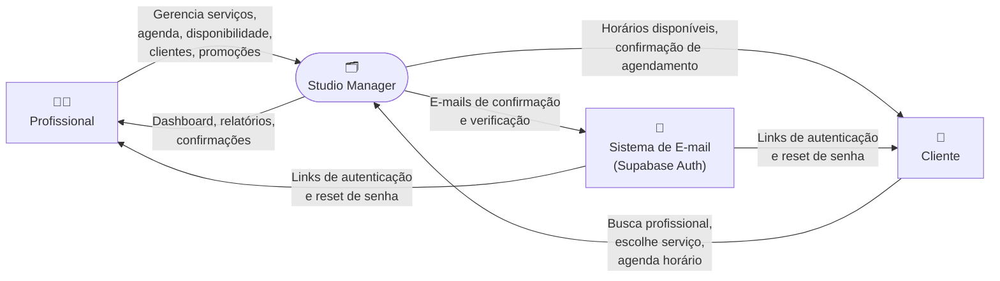
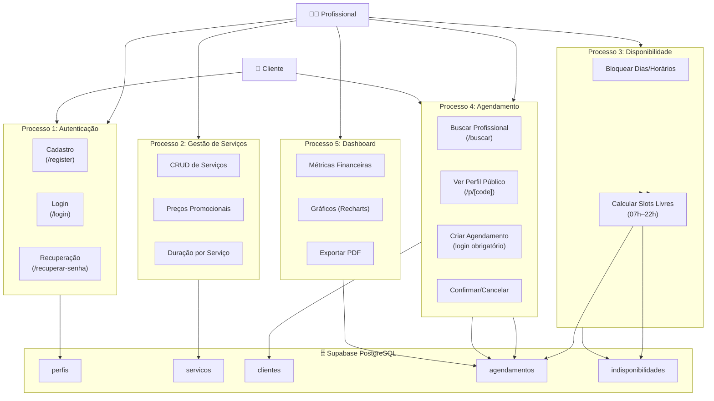
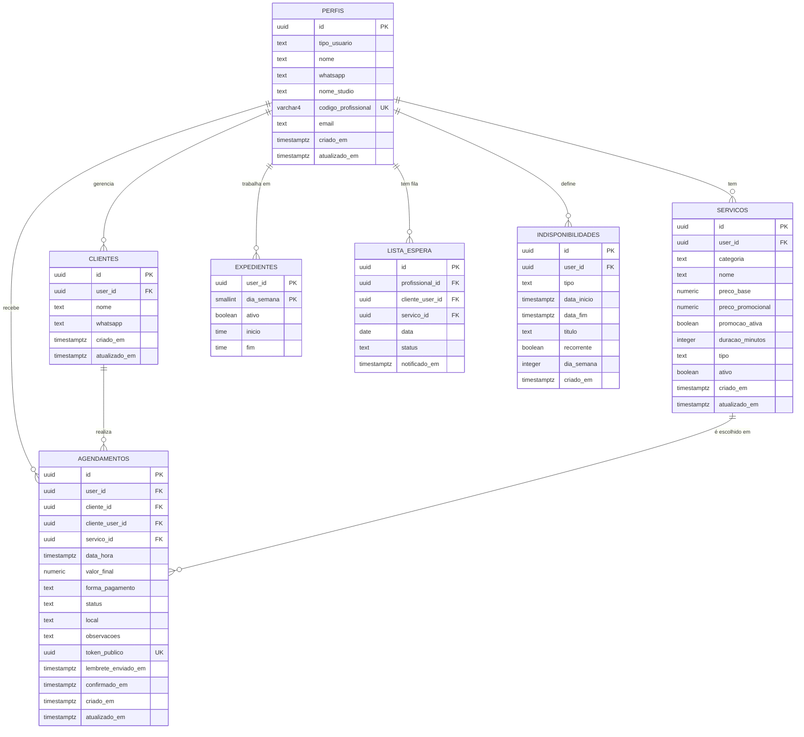
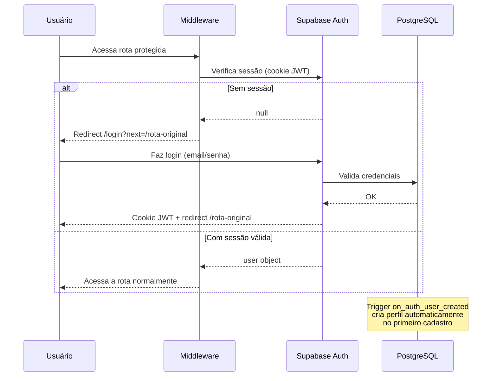
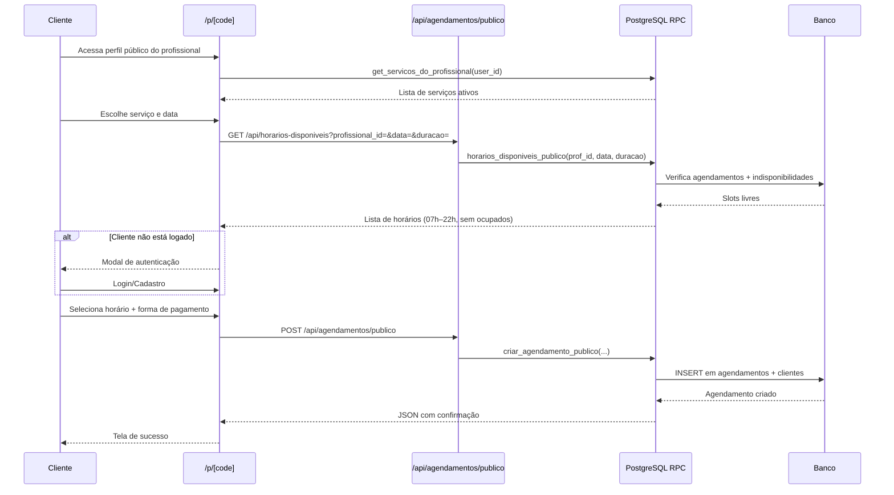
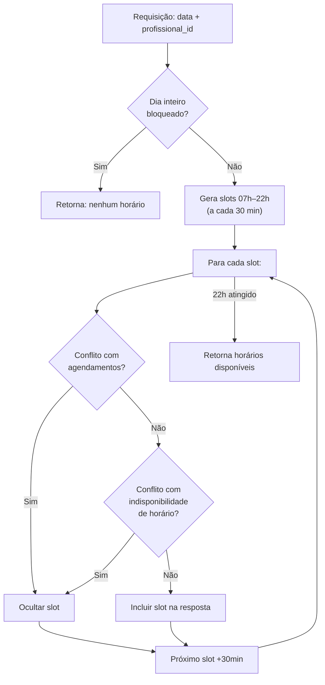
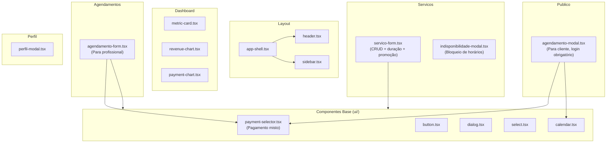

# 🏗️ Arquitetura — Studio Manager

> Documento técnico completo: arquitetura, DFD, banco de dados, fluxos e segurança.

---

## 1. Visão Geral do Sistema

O Studio Manager é uma aplicação **full-stack** com Next.js 14 (App Router) no frontend/backend e Supabase (PostgreSQL + Auth) como infraestrutura de dados. O deploy é feito na Vercel com CI/CD automático.



---

## 2. DFD — Nível 0 (Diagrama de Contexto)

Visão de mais alto nível: o sistema e suas entidades externas.



---

## 3. DFD — Nível 1 (Processos Principais)



---

## 4. Diagrama de Banco de Dados (ER)



---

## 5. Fluxo de Autenticação



---

## 6. Fluxo de Agendamento (Cliente)



---

## 7. Fluxo de Disponibilidade de Horários



---

## 8. Mapa de Componentes



---

## 9. Segurança — RLS e RPCs

### Row Level Security (RLS)

Todas as tabelas têm RLS habilitado. A regra base é: **usuário só acessa dados onde `auth.uid() = user_id`**. Desde a migration 012 não há políticas públicas de INSERT: agendamentos e clientes criados pelo portal passam exclusivamente pela RPC `criar_agendamento_publico`.

| Tabela | Política | Regra |
|---|---|---|
| `perfis` | `perfis_read_own` | `auth.uid() = id` |
| `perfis` | `perfis_public_read_profissionais` | `tipo_usuario = 'profissional'` (público) |
| `perfis` | `perfis_update_own` | `auth.uid() = id` |
| `servicos` | `servicos_select/insert/update/delete` | `auth.uid() = user_id` |
| `clientes` | `clientes_select/insert/update/delete` | `auth.uid() = user_id` |
| `agendamentos` | `agendamentos_select` | `auth.uid() = user_id` |
| `agendamentos` | `agendamentos_select_cliente` | `auth.uid() = cliente_user_id` |
| `indisponibilidades` | `indisponibilidades_select/insert/update/delete` | `auth.uid() = user_id` |

### RPCs SECURITY DEFINER

Funções que rodam com privilégios elevados para operações públicas (sem vazamento de dados de outros usuários):

| Função | Propósito | Acesso |
|---|---|---|
| `get_servicos_do_profissional(user_id)` | Retorna serviços ativos de UM profissional específico | `anon`, `authenticated` |
| `horarios_disponiveis_publico(prof_id, data, duracao)` | **Fonte única** do cálculo de slots livres (grade 07h–22h, término até 22h30, só horários futuros) | `anon`, `authenticated` |
| `get_horarios_disponiveis(prof_id, data, duracao)` | Legado — delega para `horarios_disponiveis_publico` | `anon`, `authenticated` |
| `get_agendamentos_ocupados(prof_id, data)` | Retorna horários ocupados (para ocultar no calendário do cliente) | `anon`, `authenticated` |
| `criar_agendamento_publico(...)` | Cria agendamento + cliente; cliente = `auth.uid()`; valida conflito/bloqueios/grade com lock por profissional | `authenticated` |
| `cancelar_agendamento_cliente(ag_id, _)` | Cliente (`auth.uid()`) cancela o próprio agendamento com 2h+ de antecedência | `authenticated` |
| `reagendar_agendamento(ag_id, _, nova_data)` | Profissional (`auth.uid()`) reagenda sem sobrepor outro agendamento | `authenticated` |
| `sm_horario_conflita(...)` | Helper interno de conflito de horário | interno |
| `generate_unique_codigo_profissional()` | Gera código único de 4 dígitos | interno (trigger) |
| `handle_new_user()` | Cria perfil automaticamente no cadastro | interno (trigger) |

---

## 10. API Routes

### `POST /api/agendamentos/publico`
Cria um novo agendamento via portal público. **Requer sessão** (cookie do Supabase Auth): a cliente é sempre o usuário logado.

**Body (JSON, validado com Zod):**
```json
{
  "codigo_profissional": "1234",
  "servico_id": "uuid",
  "data_hora": "2026-01-15T10:00:00-04:00",
  "local": "Studio",
  "forma_pagamento": "Pix",
  "cliente_nome": "Maria Silva",
  "cliente_whatsapp": "92999999999",
  "cliente_email": "maria@email.com",
  "observacoes": "Texto opcional"
}
```

**Resposta (200):** `{ success, agendamento, profissional }`.  
**Erros:** 400 (dados inválidos ou fora do expediente), 401 (não logado), 404 (profissional/serviço não encontrado), 409 (horário ocupado ou bloqueado).

---

### `POST /api/agendamentos/[id]/cancelar`
Cancela um agendamento da cliente logada (mínimo de 2h de antecedência).  
**Erros:** 400, 401, 404.

---

### `GET /api/horarios-disponiveis`
Retorna horários livres para um profissional em uma data (via RPC `horarios_disponiveis_publico`).

**Query params:**
- `profissional_id` — `user_id` do profissional (UUID)
- `data` — data no formato `YYYY-MM-DD`
- `duracao` — duração em minutos (5–480, padrão: 30)

**Resposta (200):**
```json
{ "slots": ["07:00", "07:30", "..."] }
```

---

### `POST /api/agendamentos/[id]/reagendar`
Remarcação pela cliente logada (mín. 2h). Body: `{ "data_hora": "ISO" }`. Envia e-mail para cliente e profissional e avisa a lista de espera do dia liberado.  
**Erros:** 400, 401, 404, 409.

---

### `POST /api/agenda/horario-liberado`
Chamado pelo painel do profissional ao liberar um horário. Body: `{ "data": "YYYY-MM-DD" }`. Avisa a lista de espera daquele dia.

---

### `GET /api/cron/diario`
Vercel Cron (13:00 UTC). Exige `Authorization: Bearer <CRON_SECRET>`. Envia lembretes (via `/emails/batch` da Resend) e varre a lista de espera.

---

### Página `/a/[token]`
Link do e-mail de lembrete. Mostra o agendamento e confirma presença com um clique (RPC `confirmar_presenca`). A confirmação exige clique para não ser disparada por filtros de e-mail que visitam links.

---

### `GET /api/auth/callback`
Callback do Supabase Auth após confirmação de e-mail ou OAuth.  
Redireciona para `/email-confirmado` ou `/dashboard`.

---

## 11. Variáveis de Ambiente

| Variável | Obrigatória | Descrição |
|---|---|---|
| `NEXT_PUBLIC_SUPABASE_URL` | ✅ | URL do projeto Supabase |
| `NEXT_PUBLIC_SUPABASE_ANON_KEY` | ✅ | Chave anônima pública do Supabase |

> As variáveis com prefixo `NEXT_PUBLIC_` são expostas no browser. Nunca use a `service_role` key como pública. Desde a 0.12.0 a aplicação **não usa** `SUPABASE_SERVICE_ROLE_KEY`; todas as operações públicas passam por RPCs `SECURITY DEFINER`.
>
> Para e-mails: `RESEND_API_KEY` e `RESEND_FROM_EMAIL` (remetente de um **domínio verificado** na Resend — com `resend.dev` só chega no e-mail dono da conta).
>
> `CRON_SECRET`: valor de `sm_config.cron_secret` (mostrado ao rodar a migration 013). Autoriza o cron e as RPCs de sistema `sm_*`.
>
> Opcional: `NEXT_PUBLIC_APP_URL` para os links dos e-mails (padrão: domínio de produção da Vercel).

---

## 12. Histórico de Migrations

| # | Arquivo | Descrição |
|---|---|---|
| 001 | `001_initial_schema.sql` | Schema inicial: `clientes`, `servicos`, `agendamentos` + RLS + triggers `updated_at` |
| 002 | `002_perfis_e_portal_cliente.sql` | Tabela `perfis`, trigger `handle_new_user`, `cliente_user_id`, RPC `criar_agendamento_publico` |
| 003 | `003_fix_agendamento_publico.sql` | Correções na função de agendamento público |
| 004 | `004_disponibilidade_e_promocoes.sql` | Tabela `indisponibilidades`, campos `duracao_minutos`/`preco_promocional`/`promocao_ativa`, RPC `get_horarios_disponiveis` |
| 005 | `005_pagamento_misto.sql` | Muda `forma_pagamento` de ENUM para TEXT (suporta combinações) |
| 006 | `006_horarios_07_as_22.sql` | Atualiza geração de slots para 07h–22h (era 08h–17h) |
| 007 | `007_fix_servicos_rls_e_duracao.sql` | Remove política pública de serviços; seta duração 60min p/ Cílios e Depilação |
| 008 | `008_fix_servicos_publico_rls.sql` | Cria RPC `get_servicos_do_profissional` (SECURITY DEFINER) para clientes lerem serviços |
| 009 | `009_agendamentos_ocupados_e_login_obrigatorio.sql` | RPC `get_agendamentos_ocupados`; oculta slots ocupados e bloqueados para clientes |
| 010 | `010_cancelamento_cliente_e_reagendamento.sql` | RPCs `cancelar_agendamento_cliente` (regra de 2h) e `reagendar_agendamento` |
| 011 | `011_fuso_horario_manaus.sql` | Fuso `America/Manaus` em `get_horarios_disponiveis` |
| 012 | `012_seguranca_agendamentos.sql` | Conflito de horário validado no banco (com lock), RPCs com `auth.uid()`, remoção de políticas públicas de INSERT/SELECT, RPC `horarios_disponiveis_publico`, índices |
| 013 | `013_expediente_lembretes_lista_espera.sql` | Tabelas `expedientes`, `lista_espera`, `sm_config`; colunas de lembrete/confirmação em `agendamentos`; RPCs de expediente, confirmação, remarcação pela cliente, conflitos e lista de espera |

---

## 13. Lib e Queries

```
lib/
├── supabase/
│   ├── client.ts       → Cliente Supabase para o browser (createBrowserClient)
│   └── server.ts       → Cliente Supabase para Server Components e API Routes
├── queries/
│   ├── servicos.ts     → getServicos(), createServico(), updateServico(), deleteServico(), togglePromocao(), updateDuracao()
│   ├── clientes.ts     → getClientes(), createCliente(), updateCliente(), deleteCliente()
│   ├── agendamentos.ts → getAgendamentos(), createAgendamento(), updateAgendamento(), deleteAgendamento()
│   ├── perfis.ts       → getPerfil(), updatePerfil(), getProfissionalByCodigo(), getServicosDoProfissional(), getAgendamentosDoCliente()
│   └── indisponibilidades.ts → getIndisponibilidades(), createIndisponibilidade(), deleteIndisponibilidade(), getHorariosDisponiveis()
├── email.ts            → Funções de envio de e-mail (confirmação de agendamento)
├── pdf-report.ts       → Geração de PDF com jsPDF + jspdf-autotable
└── utils.ts            → formatCurrency(), getCategoriaColor(), formatDate(), cn()
```

---

## 14. PWA (Progressive Web App)

O sistema funciona como PWA, podendo ser instalado como app no celular:

| Arquivo | Função |
|---|---|
| `public/manifest.json` | Metadados do app (nome, ícones, cores) |
| `public/sw.js` | Service Worker para cache offline |
| `public/icons/` | Ícones em 192px e 512px (normal + maskable) |
| `components/pwa/pwa-register.tsx` | Registro do Service Worker no lado cliente |

---

> 📖 Voltar para o [README.md](./README.md) | Ver [CHANGELOG.md](./CHANGELOG.md)
